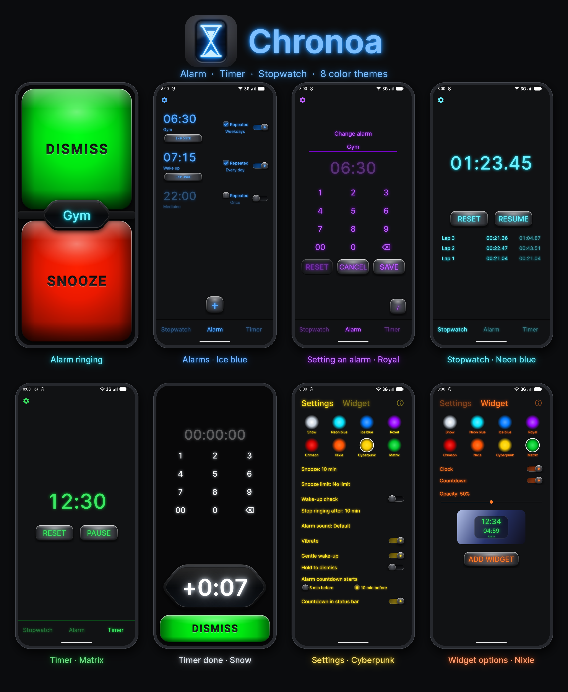

# Chronoa

An alarm clock, timer and stopwatch for Android with a glowing, retro-tech look. Built with
only the Android framework and the Kotlin standard library: no other libraries, no internet,
no accounts, no tracking.

## Features

- **Alarms:** repeat on chosen weekdays (or once), optional label, own sound per alarm, skip
  once, and a 5 or 10 minute countdown before each alarm in the status bar and widget.
- **Ringing:** a full-screen green Dismiss / red Snooze screen that takes over the phone, also
  over the lock screen. Optional gentle wake-up (volume rises over 30 s), hold to dismiss,
  a wake-up check (solve a sum to dismiss), a snooze limit, and a maximum ring time.
- **Timer:** type a time on the keypad; runs with the app closed and counts down in the status
  bar. When it's done you can type a new one straight from the ring screen.
- **Stopwatch** with laps.
- **Widgets:** a one-cell widget, and a wide one with a big clock. Both show the time and a
  countdown to the next timer or alarm.
- **Themes:** eight glow colors for the app, and separately for the widgets, with adjustable
  widget background opacity.
- 24-hour time throughout. Runs on Android 5.0 (API 21) and newer; targets API 35.

## Install

Download `Chronoa.apk` from the [Releases](../../releases) page and open it on the phone. The
first time, allow installs from that app when asked. In Chronoa, allow notifications and tap
the yellow banner if it shows; it sets up exact alarms and "Display over other apps" (if that
switch is greyed out: Settings > Apps > Chronoa > ⋮ > Allow restricted settings).

On Samsung and other phones that put apps to sleep, set Chronoa's battery usage to
**Unrestricted** so alarms are never late.

## Build

Open the folder in Android Studio, or run `./gradlew assembleRelease` (JDK 17–21). The APK lands
in `app/build/outputs/apk/release/`.

Release builds are signed with the key described in `../chronoa-signing/keystore.properties`,
which is kept outside this repository. Without it, builds fall back to the debug key.

## How it works

| File | Job |
| --- | --- |
| `MainActivity.kt` | The Stopwatch, Alarm and Timer tabs, and setting an alarm |
| `SettingsActivity.kt`, `ThemePane.kt` | Settings and the Widget tab (colors, opacity, preview) |
| `Store.kt` | Saves alarms, timer, stopwatch and settings in SharedPreferences |
| `Scheduler.kt` | Arms exact system alarms (`setAlarmClock` for alarms and snoozes) |
| `AlarmReceiver.kt` | Fires when something is due, and handles the notification buttons |
| `Ringer.kt`, `RingService.kt` | Brings up the ring screen and plays the sound |
| `RingActivity.kt`, `RingScreen.kt`, `RingView.kt`, `OverlayRing.kt` | The ring screen |
| `Timer.kt`, `Upcoming.kt` | Timer and alarm countdown notifications |
| `TimerWidget.kt` | The one-cell and wide home-screen widgets |
| `Theme.kt`, `Glow.kt`, `Controls.kt`, `Dome.kt`, `Keypad.kt` | The look: colors, glow, domed buttons, keypad |
| `BootReceiver.kt` | Re-arms everything after a reboot, an update, or a clock or time zone change |

`tools/make_icon.py` regenerates the launcher icon.

## Credits

The app's text and clock use subsets of [Inter](https://rsms.me/inter/) by Rasmus Andersson,
licensed under the SIL Open Font License 1.1.
